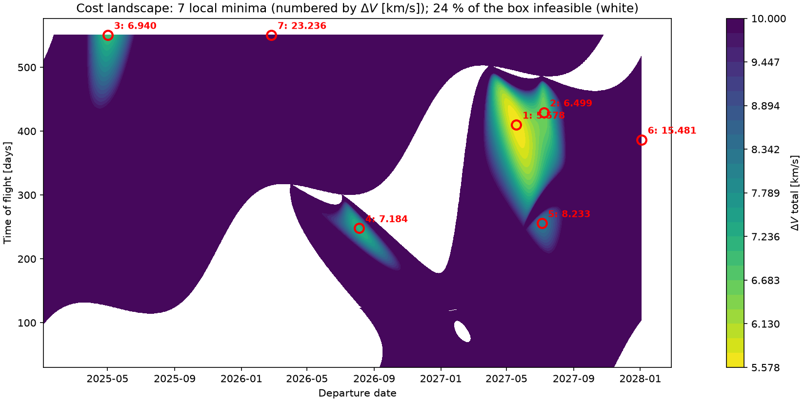
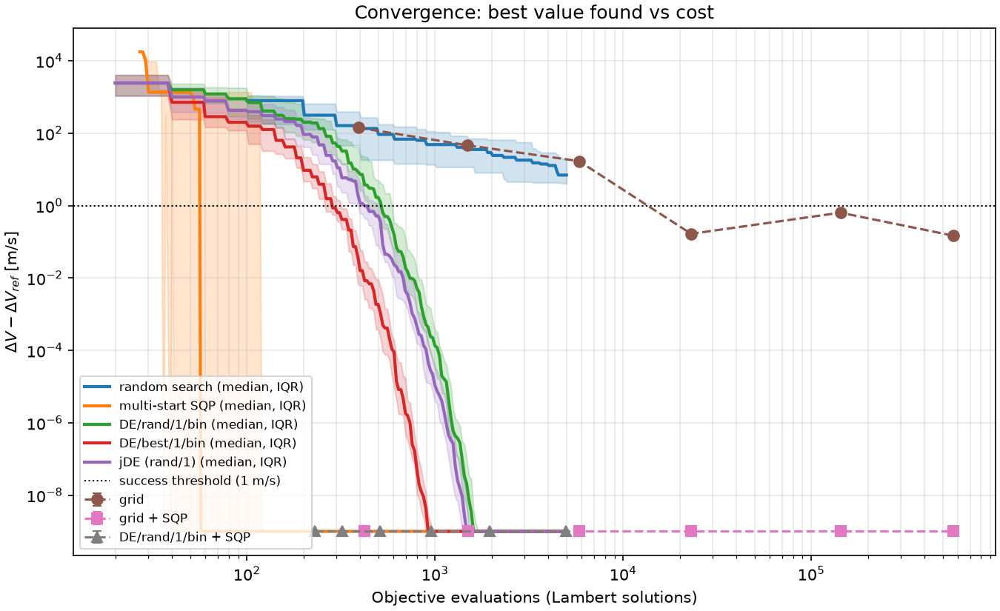
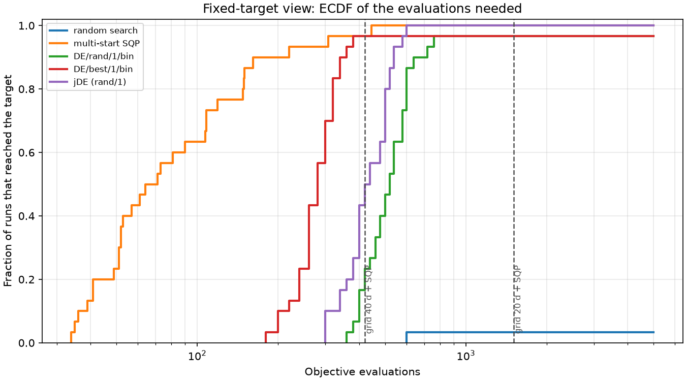
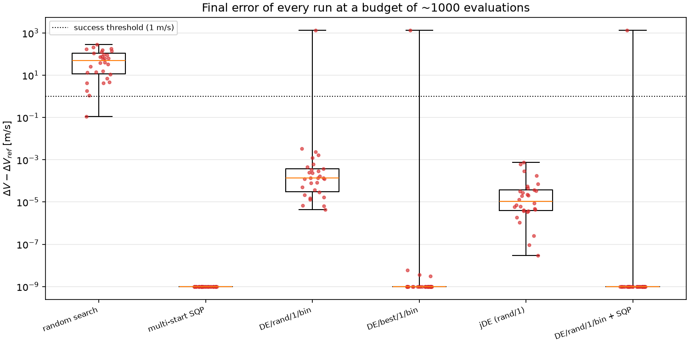
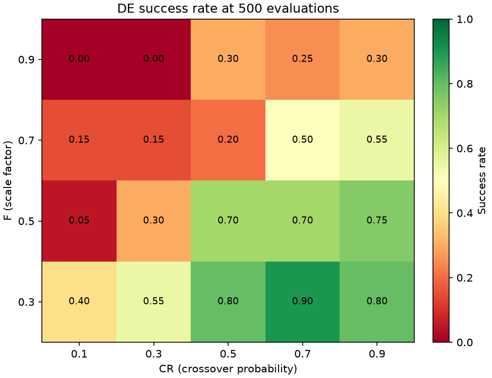

# Interplanetary Transfer Optimisation: Earth → 25143 Itokawa

[](https://github.com/FedericoCarugati/InterplanetaryTransfer_Project/actions/workflows/python-ci.yml)


[](docs/Interplanetary_Transfer_Report.pdf)

Preliminary mission design of a rendezvous with the near-Earth asteroid **25143 Itokawa**.
The project starts from my BSc thesis in Aerospace Engineering (Politecnico di Milano, 2025,
MATLAB) and extends its interplanetary phase in Python with:

1. a **Lambert-based formulation** of the heliocentric transfer, validated against the thesis code;
2. a **hybrid global–local optimiser**: Differential Evolution written from scratch
   (four variants, including the self-adaptive jDE) followed by SQP refinement;
3. an **equal-budget statistical benchmark** against the thesis grid search and other baselines:
   30 seeded runs per method, success rates with confidence intervals, expected running time,
   non-parametric hypothesis tests and a parameter sensitivity study.

All results are reproducible from fixed seeds, and the code is covered by 52 automated tests
run in continuous integration.

**Technical report:** [Interplanetary_Transfer_Report.pdf](docs/Interplanetary_Transfer_Project.pdf)
(66 pages: theory, methodology, full results and discussion).

---

## Key results

| | Thesis (MATLAB) | This work (Python) |
| --- | --- | --- |
| Best rendezvous transfer, 2025–2028 window | 5.7204 km/s | **5.5777 km/s** (−142 m/s) |
| Departure / time of flight | 30 May 2027 / 393.4 d | 19 May 2027 / 410.0 d |
| Cost of the search | 4.5·10⁹ conics, ≈ 6 h | 570 495 Lambert solutions, < 1 s (1-day grid) |
| Cost to reach the global minimum within 1 m/s | — | **≈ 440–700 evaluations** (DE variants, expected running time) |
| Independent check of the optimum | — | Kepler propagation of the Lambert arc ends 6·10⁻⁷ km from Itokawa |

Main findings of the benchmark:

* Every optimiser that combines a global exploration with a local descent finds the global
  minimum with **≈ 10³ times fewer evaluations** than the thesis-like 1-day grid, and at machine precision.
* In this two-variable problem the global basin of attraction covers ≈ 36 % of the search box,
  so a **random multi-start SQP** is the most efficient method in number of evaluations.
  The population-based methods are **3–4 times faster in wall-clock time**, because they
  evaluate whole populations in a single vectorised call.
* Among the DE variants the expected **exploration–exploitation trade-off** is clearly measured.
  The self-adaptive **jDE** is the only one with 30/30 successes, and it matches the best
  hand-tuned (F, CR) settings without any tuning.
* The only failure mode observed is **premature convergence** of the population into a
  secondary minimum lying on the boundary of the time-of-flight range.

---

## Repository layout

| Folder | Content |
| --- | --- |
| [`MatlabCode/`](MatlabCode) | Original thesis code (MATLAB), three mission phases |
| [`PythonCode/`](PythonCode) | Python package `itokawa_opt`: models, optimisers, benchmark, tests |
| [`.github/workflows/`](.github/workflows) | Continuous integration: the test suite runs on every push and pull request |
| [`docs/`](docs) | Technical report (PDF) |

---

## 1. The thesis project (MATLAB)

The mission is split into three phases, each solved as a separate scenario:

| Scenario | Phase | Reference frame | Method |
| --- | --- | --- | --- |
| 1 | Transfer from the initial Earth orbit to a parking orbit | Geocentric | Comparison of impulsive strategies (standard and alternative, e.g. bi-elliptic) |
| 2 | Interplanetary transfer Earth → Itokawa | Heliocentric | Grid search over the transfer geometry |
| 3 | Escape from the parking orbit and capture at Itokawa | Patched conics | Hyperbolic escape and capture manoeuvres |

Scenario 2 was solved by brute force: three nested loops over the Earth departure position,
the asteroid arrival position and the argument of pericentre of the transfer conic.
Two versions were developed:

* **Standard**: the energetically optimal conic between the two orbits, without imposing that
  Itokawa is at the arrival point at the right time: 4.3008 km/s, TOF 222.8 days (no rendezvous).
* **Advanced**: the rendezvous is imposed through a time-tolerance window on the arrival epoch:
  **5.7204 km/s**, departure 30 May 2027, TOF 393.4 days, running time about 6 hours.

The Python extension addresses Scenario 2.

---

## 2. Problem formulation

### 2.1 From grid search to Lambert's problem

For given departure and arrival positions, the thesis loop over the argument of pericentre scans
the one-parameter family of conics through the two points, looking for the one whose time of
flight matches the asteroid's. This is exactly **Lambert's problem**, which can be solved directly.
Given the departure epoch $t_0$ and the time of flight $T$, the solver returns the conic that
connects $\mathbf r_\oplus(t_0)$ to $\mathbf r_A(t_0+T)$ in exactly $T$:

```math
(\mathbf v_1,\mathbf v_2) = \mathrm{Lambert}\big(\mathbf r_\oplus(t_0),\ \mathbf r_A(t_0+T),\ T\big)
```

The transfer cost becomes a function of two variables only:

```math
\Delta V(t_0,T) = \lVert \mathbf v_1-\mathbf v_\oplus(t_0)\rVert + \lVert \mathbf v_A(t_0+T)-\mathbf v_2\rVert
```

### 2.2 Optimisation problem

```math
\min_{t_0,\,T}\ \Delta V(t_0,T)
\quad \text{s.t.} \quad
g(t_0,T) = \frac{r_{\min,\odot} - \min_{\text{arc}} r(t)}{\mathrm{AU}} \le 0,
\qquad t_0\in[0,\,3\,T_\oplus],\quad T\in[30\ \mathrm d,\ T_A]
```

* $r_{\min,\odot} = 0.7$ AU is the minimum Sun distance along the arc (thermal constraint of the thesis).
* The departure window covers three Earth revolutions from the perihelion of 4 January 2025
  (2025–2028); the time of flight is bounded by one orbital period of Itokawa ($T_A \approx 551$ d).
* Failed Lambert solutions and constraint violations are handled explicitly by the optimisers
  (Section 4).

### 2.3 Model assumptions

| Item | Assumption |
| --- | --- |
| Dynamics | Two-body heliocentric problem, $\mu_\odot = 1.327\cdot10^{11}$ km³/s² (thesis value) |
| Ephemerides | Fixed Keplerian elements for Earth and Itokawa (thesis model; Itokawa from the JPL Horizons state) |
| Manoeuvres | Impulsive, at departure and arrival (heliocentric $\Delta V$, no escape/capture hyperbolas) |
| Transfer | Prograde, zero-revolution Lambert arcs, solved with Izzo's algorithm (2015) compiled with Numba |

---

## 3. Validation against the thesis

### 3.1 Results (thesis Keplerian model, 2025–2028)

| Check | Python | MATLAB |
| --- | --- | --- |
| Itokawa elements from the JPL Horizons state | identical (rel. error 1e-16) | — |
| Lambert evaluated at the MATLAB optimum (same $t_0$, $T$) | 5.7206 km/s | 5.7204 km/s (0.003 %) |
| Best transfer, 3rd Earth revolution (Lambert grid + SQP) | **5.5777 km/s**, dep. 19 May 2027, TOF 410.0 d | 5.7204 km/s |
| Best transfer, 1st / 2nd revolution | 6.94 / 7.18 km/s | 7.99 / 7.90 km/s |
| Faithful Python port of the three MATLAB loops | 5.6660 km/s | 5.7204 km/s |
| Cost of the search | 570 495 Lambert solutions in < 1 s | 4.5·10⁹ conics in ≈ 6 h |

The Lambert solver itself is verified independently in the test suite: random cases are propagated
with Kepler's equation and must land on the target, and the results are cross-checked against
ESA's `pykep`.

The second row of the table shows that both codes compute the same cost function. The third row
shows that the Lambert formulation finds a transfer 0.14 km/s cheaper **in the same model**.

### 3.2 Why Lambert is better, and not by chance

* **The rendezvous is solved, not sampled.** It is an equality constraint: in the three-dimensional
  grid its solutions lie on a surface that grid points almost never hit. With a ±12 s window and a
  10⁴ s step, only 350 of the 4.5·10⁹ MATLAB conics pass the test (about one in 13 million).
  Lambert eliminates the third variable, and every evaluation is a valid rendezvous.
* **The search is denser where it matters.** 570 thousand valid transfers on a regular 1-day grid
  in $(t_0, T)$, against 350 valid transfers scattered where the tolerance window happened to catch them.
* **The minimum is continuous.** SQP moves freely in $(t_0, T)$ and converges to the bottom of the
  basin, instead of being restricted to grid nodes.

The difference between the MATLAB result (5.720) and the Python port of the same loops (5.666)
is instead due to chance: with so few valid conics, tiny numerical differences in the propagation
change which ones fall inside the window.

### 3.3 Notes on the original MATLAB code

Found while porting it (details in `PythonCode/src/itokawa_opt/optimizers/grid_matlab.py`):

1. The transfer plane normal is `r_A × r_E`, so only prograde arcs longer than 180° are generated.
   Here the optimum is a 272° arc, so the result is unaffected; Lambert explores both cases.
2. The stored anomalies are one time step behind the positions actually used.
3. The time indices wrap with `N·dt`, not exactly the orbital period: after the wraps the Earth and
   asteroid clocks differ by about 8.5·10³ s, much more than the ±12 s window.
4. `deltaV_map` stores the last feasible value, not the minimum.

---

## 4. Optimisation methods

The optimisation follows the standard two-step scheme of trajectory design: a **global search**
locates the best basin of the cost landscape, then a **local gradient-based method** converges to
the exact minimum.

### 4.1 Differential Evolution (written from scratch)

`optimizers/de.py`. A population of $NP$ candidate solutions evolves in the normalised box
$[0,1]^D$. At every generation each target vector $\mathbf x_i$ generates a trial vector through:

```math
\begin{aligned}
&\text{mutation:}  && \mathbf v_i = \mathbf b_i + F\,(\mathbf x_{r_1}-\mathbf x_{r_2}) \\
&\text{crossover:} && u_{ij} = \begin{cases} v_{ij} & \text{if } \mathrm{rand}_{ij}\le CR \ \text{ or } \ j=j_{\mathrm{rand}} \\ x_{ij} & \text{otherwise} \end{cases} \\
&\text{selection:} && \mathbf x_i \leftarrow \mathbf u_i \ \text{ if } \mathbf u_i \text{ is not worse than } \mathbf x_i
\end{aligned}
```

The difference vector $\mathbf x_{r_1}-\mathbf x_{r_2}$ adapts the step length and direction to the
spread and shape of the population: long steps while it is scattered (exploration), short steps
aligned with the valley once it has converged (exploitation).

| Feature | Implementation |
| --- | --- |
| Strategies | `rand/1/bin` ($\mathbf b_i=\mathbf x_{r_0}$), `best/1/bin` ($\mathbf b_i=\mathbf x_{best}$), `current-to-best/1/bin` |
| Self-adaptation | **jDE** (Brest et al., 2006): each individual carries its own $F_i$, $CR_i$ |
| Scale factor | Constant, or *dither*: $F\sim\mathcal U(0.5,1)$ redrawn at every generation |
| Initialisation | Latin hypercube sampling (one point per stratum of each variable) |
| Bound handling | *Bounce-back*: midpoint between the parent and the violated bound |
| Constraints | **Deb's feasibility rules**: feasible beats infeasible; two feasible → lower $\Delta V$; two infeasible → lower violation. No penalty weight to tune |
| Vectorisation | Generation-synchronous update: the whole population is evaluated in **one** call to the batch objective |
| Reproducibility | All randomness from a `numpy.random.Generator` seeded per run |
| Stopping | Evaluation budget, stall of the best value, or collapse of the population |

**jDE.** Before mutation, each individual resamples its parameters with probability $\tau=0.1$:

```math
F_i' = \begin{cases} 0.1 + 0.9\,\mathrm{rand} & \text{w.p. } \tau \\ F_i & \text{otherwise} \end{cases}
\qquad
CR_i' = \begin{cases} \mathrm{rand} & \text{w.p. } \tau \\ CR_i & \text{otherwise} \end{cases}
```

The trial vector uses $(F_i', CR_i')$. The new parameters survive only if the trial wins the
selection, so successful parameters are inherited together with the individuals they produced.

### 4.2 Sequential Quadratic Programming

`optimizers/local.py`, SciPy SLSQP (Kraft, 1988). At each iterate the problem is replaced by a
quadratic programme, with the objective modelled by a quasi-Newton (BFGS) approximation
$\mathbf B_k$ of the Hessian of the Lagrangian and the constraints linearised:

```math
\min_{\mathbf p}\ \nabla f_k^{\mathsf T}\mathbf p + \tfrac12\,\mathbf p^{\mathsf T}\mathbf B_k\,\mathbf p
\quad \text{s.t.} \quad g_k + \nabla g_k^{\mathsf T}\mathbf p \le 0
```

The step is then globalised with a line search on a merit function.

* The variables are scaled to $[0,1]$: $t_0$ and $T$ are $O(10^7\text{–}10^8)$ s, and unscaled
  variables make finite-difference gradients and the Hessian approximation ill-conditioned.
* **Fair cost accounting.** SLSQP requests the objective and the constraint separately, at the same
  points. A small cache removes the duplicates, and `nfev` counts the **distinct Lambert solutions**,
  not SciPy's objective calls.

### 4.3 Hybrid pipeline

`optimizers/pipeline.py`:

1. **Global phase.** DE explores the whole box with the budget minus a reserve for the local phase.
2. **Candidate selection.** The final population is sorted according to Deb's rules and reduced to at
   most 3 points that are mutually more than 0.02 apart in the normalised box: one representative per basin.
3. **Local phase.** SQP from every candidate; the best feasible result is kept.
4. **Independent check.** The Lambert arc of the solution is propagated with Kepler's equation for
   $T$ and must end on the asteroid. This verifies the result with code that shares nothing with the
   Lambert solver.

---

## 5. Benchmark methodology

`analysis/benchmark.py`, `analysis/stats.py`, `scripts/run_benchmark.py`.

### 5.1 Reference solution and landscape analysis

Before any comparison, the problem itself is characterised with a procedure independent of the
methods under test:

* a fine porkchop grid (0.5 days, 2 280 938 Lambert solutions);
* SQP from every grid node that is the minimum of its 7×7 neighbourhood, with duplicates removed.

This yields the best-known solution and the list of basins (Section 6.1).

### 5.2 Methods compared

| Method | Type | Role |
| --- | --- | --- |
| Lambert grid (40, 20, 10, 5, 2, 1 days) | Deterministic | Thesis-like baseline |
| Lambert grid + SQP from the best node | Deterministic | Baseline with local refinement |
| Random search | Stochastic | Lower bound: every optimiser must beat it |
| Multi-start SQP | Stochastic | Local-only method from uniformly random starts |
| DE/rand/1/bin, DE/best/1/bin, jDE | Stochastic | Global search alone |
| DE/rand/1/bin + SQP | Stochastic | Hybrid scheme (Section 4.3) |

### 5.3 Protocol

| Setting | Value |
| --- | --- |
| Cost measure | **Number of objective evaluations** (Lambert solutions), independent of the hardware. Wall-clock time is also recorded |
| Runs | 30 independent runs per method; seeds from `SeedSequence(2026).spawn(30)` |
| Budgets | 200, 300, 500, 1 000, 2 000, 5 000 evaluations |
| DE settings | $NP = 20$, $F\sim\mathcal U(0.5,1)$ (dither), $CR = 0.9$ |
| Success | Final $\Delta V$ within **1 m/s** of the best-known value (the gap to the second basin is 922 m/s) |
| Resolution of the rank tests | Errors below 1 mm/s are treated as ties |
| Parameter study | Separate master seed (7), so that parameters are never tuned on the test runs |

### 5.4 Statistics

The final errors of a stochastic optimiser are not Gaussian: they are skewed and bimodal (runs in
the global basin close to zero, runs trapped elsewhere at the gap between basins). All statistics
are therefore **non-parametric**.

| Quantity | Question answered | Definition |
| --- | --- | --- |
| Median, interquartile range | Typical result and spread across runs | 50th, 25th, 75th percentiles |
| Success rate with **Wilson** 95 % interval | How likely is the method to find the global minimum? | Score interval of a binomial proportion, valid at $\hat p = 0$ or $1$ |
| Evaluations to target, **ECDF** | How much does it cost to reach the target, and how variable is that cost? | First evaluation count at which the best-so-far error is ≤ 1 m/s |
| **Expected running time** (ERT) | Average cost of a "restart until success" strategy | $\mathrm{ERT} = \big(\sum_{\text{succ.}} n_k + \sum_{\text{fail}} B_k\big)/\#\text{successes}$ |
| **Mann–Whitney U** | Does a run of A tend to give lower errors than a run of B? | Rank-sum test, two-sided |
| **Vargha–Delaney** $\hat A_{12}$ | How large is the difference? | $P(a<b)+\tfrac12 P(a=b)$; 0.5 = no difference |
| **Fisher exact test** | Are the success counts different? | Hypergeometric test on the 2×2 success/failure table |
| **Holm** correction | Several comparisons made together | Keeps the family-wise error rate at 5 % |

---

## 6. Results

All figures are generated by `python scripts/run_benchmark.py --sensitivity`
(the copies used in this README are in `PythonCode/docs/figures/`).

### 6.1 Cost landscape



| Basin | ΔV [km/s] | Departure | TOF [d] | On a bound |
| --- | --- | --- | --- | --- |
| **1** | **5.577655** | 2027-05-19 | 410.04 | no |
| 2 | 6.499270 | 2027-07-08 | 429.24 | no |
| 3 | 6.939613 | 2025-05-01 | 550.51 | yes (max TOF) |
| 4 | 7.184048 | 2026-08-04 | 247.86 | no |
| 5 | 8.232806 | 2027-07-04 | 255.76 | no |
| 6 | 15.481176 | 2028-01-03 | 386.54 | yes (end of window) |
| 7 | 23.235793 | 2026-02-25 | 550.51 | yes (max TOF) |

24.3 % of the search box is infeasible (Lambert failure or perihelion below 0.7 AU). The feasible
region consists of separate "islands". The global minimum lies in a large island in 2027, whose
basin of attraction for SQP covers about 36 % of the box. Basins 3, 6 and 7 are cut by the bounds of
the box, a typical trap for population-based methods.

### 6.2 Deterministic baseline

| Grid step | Evaluations | Error [m/s] | + SQP: evaluations | + SQP: error [m/s] |
| --- | --- | --- | --- | --- |
| 40 d | 392 | 142.2 | **420** | < 10⁻⁹ |
| 20 d | 1 485 | 46.6 | 1 507 | < 10⁻⁹ |
| 10 d | 5 830 | 17.0 | 5 855 | < 10⁻⁹ |
| 5 d | 22 995 | 0.17 | 23 012 | < 10⁻⁹ |
| 2 d | 143 028 | 0.64 | 143 048 | < 10⁻⁹ |
| 1 d | 570 495 | 0.15 | 570 516 | < 10⁻⁹ |

Two observations:

* Without refinement the error is **not monotonic** in the step (2 d is worse than 5 d). Near a
  smooth minimum the error is bounded by $O(h^2)$, but its actual value depends on how close the
  nearest node happens to fall to the minimum.
* With SQP, even a 40-day grid lands in the global basin, because the basin is wide.

### 6.3 Stochastic methods: fixed budget

Success rate [95 % Wilson interval] / median error at the given budget (30 runs):

| Method | 300 eval. | 500 eval. | 1 000 eval. | 5 000 eval. |
| --- | --- | --- | --- | --- |
| Random search | 0.00 / 160 m/s | 0.00 / 93 m/s | 0.03 / 49 m/s | 0.03 / 7.0 m/s |
| Multi-start SQP | 0.93 [0.79, 0.98] / < 10⁻⁹ | 1.00 [0.89, 1.00] / < 10⁻⁹ | 1.00 / < 10⁻⁹ | 1.00 / < 10⁻⁹ |
| DE/rand/1/bin | 0.00 / 43 m/s | 0.47 [0.30, 0.64] / 1.3 m/s | 0.97 [0.83, 0.99] / 1.3·10⁻⁴ m/s | 0.97 / < 10⁻⁹ |
| DE/best/1/bin | 0.70 [0.52, 0.83] / 0.64 m/s | 0.97 / 1.1·10⁻³ m/s | 0.97 / < 10⁻⁹ | 0.97 / < 10⁻⁹ |
| jDE | 0.10 / 11 m/s | 0.80 [0.63, 0.90] / 0.36 m/s | **1.00** / 1.1·10⁻⁵ m/s | **1.00** / < 10⁻⁹ |
| DE/rand/1/bin + SQP | **0.97** [0.83, 0.99] / < 10⁻⁹ | 0.97 / < 10⁻⁹ | 0.97 / < 10⁻⁹ | 0.97 / < 10⁻⁹ |



The convergence plot shows the median (line) and interquartile range (band) of the best-so-far error
across the 30 runs. For the DE variants three phases are visible:

1. an exploration phase, where they behave like a well-spread sampling;
2. a breakaway, when the population enters the global basin (first for `best/1`, last for `rand/1`);
3. a **linear convergence**, where the error is reduced by a roughly constant factor per generation
   (≈ 0.5 for `best/1`, ≈ 0.7 for `rand/1`).

Random search improves only as $\approx N^{-1}$, the rate expected in two dimensions.

### 6.4 Stochastic methods: fixed target (error ≤ 1 m/s)

| Method | Successful runs | Median evaluations | ERT |
| --- | --- | --- | --- |
| Random search | 1/30 | 600 | 145 600 |
| **Multi-start SQP** | 30/30 | **68** | **102** |
| DE/rand/1/bin | 29/30 | 520 | 690 |
| DE/best/1/bin | 29/30 | 280 | 452 |
| jDE | 30/30 | 430 | 439 |
| Grid 40 d + SQP (deterministic) | 1/1 | 420 | 420 |



The multi-start SQP result agrees with a simple model: each start reaches the global minimum with
probability $p_b \approx 0.365$ (the relative size of its basin of attraction), at a cost of about 37
evaluations. Hence $\mathrm{ERT}\approx 37/p_b \approx 101$, and with 5 starts (200 evaluations)
$1-(1-p_b)^5 \approx 0.90$, against the measured 102 and 0.90.

### 6.5 Final errors and hypothesis tests (1 000 evaluations)



| Hybrid vs | $\hat A_{12}$ | $p$ Mann–Whitney (Holm) | Successes | $p$ Fisher (Holm) |
| --- | --- | --- | --- | --- |
| Random search | 0.97 | 2.3·10⁻¹⁰ | 29/30 vs 1/30 | 7.6·10⁻¹⁴ |
| Multi-start SQP | 0.48 | 1.0 | 29/30 vs 30/30 | 1.0 |
| DE/rand/1/bin | 0.56 | 0.40 | 29/30 vs 29/30 | 1.0 |
| DE/best/1/bin | 0.50 | 1.0 | 29/30 vs 29/30 | 1.0 |
| jDE | 0.48 | 1.0 | 29/30 vs 30/30 | 1.0 |

At 1 000 evaluations all methods except random search have reached the target, so the tests find no
difference among them. The differences lie at **small budgets** (Section 6.3: at 300 evaluations the
hybrid succeeds in 97 % of the runs, plain DE/rand in none). SQP reduces the median error of the DE
solution from 2.4·10⁻⁴ m/s to machine precision with only **16 additional evaluations**.

The single failure shared by the DE-based methods is the same seed, which converges prematurely
into basin 3, on the time-of-flight bound. It is the same seed because the DE-based methods share
their seeds (common random numbers): they start from the same initial population.

### 6.6 Wider launch window (10 years)

With `--window-revs 10` (15 runs per method), basins from different synodic periods compete:
5.4103 km/s (15 May 2033), 5.4966 km/s (2030) and 5.5777 km/s (2027), with a gap of only 86 m/s
between the first two.

| Method | Success at 5 000 eval. | ERT |
| --- | --- | --- |
| Multi-start SQP | 1.00 | 181 |
| DE/rand/1/bin | 0.93 | 1 354 |
| jDE | 0.87 | 1 548 |
| DE/best/1/bin | **0.47** | 6 074 |
| Grid 40 d + SQP | deterministic | 1 314 |

The greedy `best/1` strategy, the fastest in the 3-year window, fails in half of the runs when
several nearly equivalent basins compete. The cost of the cheapest successful grid grows with the
size of the window (420 → 1 314 evaluations), as expected for a grid.

### 6.7 Sensitivity to the DE control parameters



Success rate of DE/rand/1/bin with constant $F$ at 500 evaluations (20 runs per cell):

| F \ CR | 0.1 | 0.3 | 0.5 | 0.7 | 0.9 |
| --- | --- | --- | --- | --- | --- |
| 0.3 | 0.40 | 0.55 | 0.80 | **0.90** | 0.80 |
| 0.5 | 0.05 | 0.30 | 0.70 | 0.70 | 0.75 |
| 0.7 | 0.15 | 0.15 | 0.20 | 0.50 | 0.55 |
| 0.9 | 0.00 | 0.00 | 0.30 | 0.25 | 0.30 |

* **Low CR fails.** With CR = 0.1 a trial changes mostly one variable at a time, i.e. it moves
  parallel to the axes, while the valleys of the porkchop are diagonal ($t_0$ and $T$ are coupled).
* **High F is slow at this budget.** The expected variance amplification of the population by
  mutation and crossover (Zaharie, 2002),
  $c = 2F^2 CR - 2CR/NP + CR^2/NP + 1$, is ≈ 2.4 for $F = CR = 0.9$ and ≈ 1.1 for $F = 0.3$,
  $CR = 0.9$. Large $F$ keeps the population spread out and delays convergence.
* With 20 runs per cell the 95 % interval is about ±0.2, so the conclusion is a **robust region**
  ($F \le 0.5$, $CR \ge 0.5$, success 70–90 %) rather than a single optimum.
* jDE reaches 80 % at the same budget **without tuning**, matching the best hand-tuned cells.

### 6.8 Evaluations versus wall-clock time

On the reference machine one evaluation costs **0.6 µs in a batch call** and **≈ 1.3 ms in a single
call**: the fixed overhead of a call dominates.

| Method | Time for 30 × 5 000 evaluations | Per evaluation | Estimated time to target (ERT × cost) |
| --- | --- | --- | --- |
| Multi-start SQP (one point per call) | 197.8 s | 1.32 ms | ≈ 0.13 s |
| DE variants (20 points per call) | ≈ 10 s | 0.067 ms | ≈ 0.03–0.05 s |
| Random search (100 points per call) | 2.0 s | 0.013 ms | ≈ 1.9 s |

The ranking depends on the cost measure. In evaluations, which measure the efficiency of the
algorithm, multi-start SQP wins. In time, which measures the implementation, the population-based
methods win thanks to vectorisation. This is the motivation for the planned GPU step (Section 8).

---

## 7. Conclusions and limitations

**Conclusions**

1. The Lambert formulation turns a 6-hour, three-dimensional sampling of a rendezvous condition
   into a smooth two-variable problem, solved exactly, and finds a transfer **142 m/s cheaper** than
   the thesis result in the same dynamical model.
2. All methods that combine exploration with a local descent find the global minimum at machine
   precision with **10²–10³ evaluations**, three orders of magnitude fewer than the thesis-like grid.
3. In this two-variable problem the global basin is large (≈ 36 % of the box), so the **simplest
   adequate method**, multi-start SQP or even a coarse grid followed by SQP, is also the most
   efficient in evaluations. The benchmark quantifies when a global optimiser is actually needed:
   when the basin of attraction of the global minimum is small.
4. The DE variants show the expected exploration–exploitation trade-off. **jDE is the most robust**
   variant (30/30 successes in the 3-year window) and needs no parameter tuning.

**Limitations**

* **Model fidelity.** Fixed Keplerian elements and impulsive heliocentric manoeuvres. Differences
  below ≈ 1 m/s are numerically meaningful but physically irrelevant. The benchmark therefore
  measures *reliability* (finding the right basin) rather than ultimate precision.
* **Problem dimension.** Two decision variables; the value of global optimisation grows with
  dimension and ruggedness, which this problem does not yet exercise.
* **Statistical design.** The DE-based methods share seeds (paired runs), while the reported tests
  assume independent samples. This makes them conservative; paired tests (Wilcoxon signed-rank,
  McNemar) would be more powerful. The ERT is reported without a confidence interval (bootstrap
  planned).
* **Grid baseline.** Its result depends on the arbitrary alignment of the nodes; a randomly shifted
  grid would turn it into a distribution comparable with the stochastic methods.

---

## 8. Future work

| Step | Content | Status |
| --- | --- | --- |
| Validation | Kepler and element conversions, Lambert solver, MATLAB port, Lambert grid + SQP | ✅ done |
| Global optimisation | DE from scratch (rand/1, best/1, current-to-best/1, jDE), hybrid DE + SQP, statistical benchmark | ✅ done |
| GPU acceleration | Lambert solver as a `numba.cuda` device function, DE population resident on the GPU, FP64 vs FP32, speed-up study | planned (`gpu/`) |
| Reference optimisers | Comparison with `pygmo` (SADE, CMA-ES, monotonic basin hopping, archipelago model) | planned (`optimizers/pygmo_adapter.py`) |
| High-fidelity ephemerides | SPICE kernels (DE440 + Itokawa SPK) with the same `rv(t)` interface | planned (`ephemeris/spice.py`) |
| Harder problems | Earth–Itokawa–Earth round trip with stay time (4 variables), multi-revolution Lambert arcs, MGA-1DSM formulations | planned |
| Statistics | Paired tests, bootstrap confidence intervals of the ERT, randomly shifted grid baseline | planned |
| Robust design | Monte Carlo on launch delays and injection errors; optimisation of a percentile of the ΔV | planned |

---

## Running the code

```bash
cd PythonCode
python3 -m venv .venv && source .venv/bin/activate
pip install -e ".[dev]"

python scripts/run_validation.py          # validation against the thesis, ~10 s
                                          #   (--matlab-grid: faithful port of the MATLAB loops, ~15 min)
python scripts/plot_tof_vs_omega.py       # thesis loop over omega vs Lambert's exact solution
python scripts/run_benchmark.py           # benchmark, ~4 min
python -m pytest                          # 52 automated tests, ~30 s
```

Options of `run_benchmark.py`:

| Option | Default | Meaning |
| --- | --- | --- |
| `--runs` | 30 | Independent runs per method |
| `--budgets` | 200 300 500 1000 2000 5000 | Evaluation budgets for the comparison |
| `--compare-budget` | 1000 | Budget of the hypothesis tests |
| `--tol` | 1e-3 km/s | Success threshold |
| `--resolution` | 1e-6 km/s | Differences ignored by the rank tests |
| `--pop-size` | 20 | DE population size |
| `--window-revs` | 3 | Launch window in Earth years |
| `--ref-step` | 0.5 d | Step of the reference grid |
| `--sensitivity` | off | Adds the F × CR study |
| `--quick` | off | 5 runs, 3 budgets (smoke test, ~20 s) |

Outputs are written to `PythonCode/results/validation/` and `PythonCode/results/benchmark/`
(`summary.json`, one `records_*.json` per method, and the figures).

---

## Code structure

`PythonCode/src/itokawa_opt/`:

| Module | Content |
| --- | --- |
| `constants.py` | Physical constants and units |
| `astro/kepler.py` | Kepler's equation, propagation in true anomaly, time of flight |
| `astro/elements.py` | Cartesian state ↔ orbital elements |
| `astro/lambert.py` | Izzo's Lambert solver (Numba), single and batch versions |
| `ephemeris/thesis_kepler.py` | Earth and Itokawa from the thesis Keplerian elements |
| `problems/direct_transfer.py` | $\Delta V(t_0,T)$ and Sun-distance constraint; scalar (`fitness`) and vectorised (`fitness_batch`) interfaces |
| `optimizers/grid_matlab.py` | Faithful port of the thesis triple loop |
| `optimizers/grid_lambert.py` | Lambert porkchop grid |
| `optimizers/de.py` | Differential Evolution (strategies, jDE, Deb's rules, LHS, bounce-back) |
| `optimizers/local.py` | SQP refinement with scaled variables and exact evaluation count |
| `optimizers/pipeline.py` | Hybrid DE → candidate selection → SQP → independent check |
| `analysis/benchmark.py` | Reference solution, basin detection, methods with a common interface, seeded runs, persistence |
| `analysis/stats.py` | Wilson interval, ERT, ECDF, Mann–Whitney U, $\hat A_{12}$, Fisher, Holm |
| `viz/plots.py` | Porkchop and transfer plots |
| `viz/benchmark_plots.py` | Benchmark figures |

Tests (`PythonCode/tests/`):

| File | What is verified |
| --- | --- |
| `test_kepler.py` | Kepler's equation and element conversions (round trips, limit cases) |
| `test_lambert.py` | Lambert arcs propagated onto the target; agreement with ESA `pykep` |
| `test_validation_thesis.py` | Thesis model, MATLAB reference values, Lambert grid + SQP |
| `test_de.py` | DE building blocks; convergence on sphere, Rosenbrock and Rastrigin; constraints; reproducibility; budget and bounds |
| `test_stats.py` | Every statistic against values computed by hand |
| `test_pipeline.py` | Batch vs scalar objective; SQP evaluation count; hybrid finds the global minimum; independent Kepler check; benchmark records |

**Conventions.** Units km, s, km/s, rad. $t = 0$ is the Earth perihelion of 4 January 2025.
The validation uses the thesis values ($\mu_\odot = 1.327\cdot10^{11}$ km³/s², fixed Keplerian elements).

---

## References

* D. Izzo, "Revisiting Lambert's problem", *Celestial Mechanics and Dynamical Astronomy* 121 (2015) 1–15.
* R. Storn, K. Price, "Differential Evolution – A simple and efficient heuristic for global optimization over continuous spaces", *Journal of Global Optimization* 11 (1997) 341–359.
* K. Price, R. Storn, J. Lampinen, *Differential Evolution: A Practical Approach to Global Optimization*, Springer, 2005.
* J. Brest, S. Greiner, B. Bošković, M. Mernik, V. Žumer, "Self-adapting control parameters in differential evolution", *IEEE Transactions on Evolutionary Computation* 10 (2006) 646–657.
* D. Zaharie, "Critical values for the control parameters of differential evolution algorithms", *Proc. MENDEL 2002*, 62–67.
* K. Deb, "An efficient constraint handling method for genetic algorithms", *Computer Methods in Applied Mechanics and Engineering* 186 (2000) 311–338.
* D. Kraft, "A software package for sequential quadratic programming", DFVLR-FB 88-28, 1988.
* N. Hansen et al., "COCO: a platform for comparing continuous optimizers in a black-box setting", *Optimization Methods and Software* 36 (2021) 114–144.
* E. B. Wilson, "Probable inference, the law of succession, and statistical inference", *Journal of the American Statistical Association* 22 (1927) 209–212.
* H. B. Mann, D. R. Whitney, "On a test of whether one of two random variables is stochastically larger than the other", *Annals of Mathematical Statistics* 18 (1947) 50–60.
* A. Vargha, H. D. Delaney, "A critique and improvement of the CL common language effect size statistics of McGraw and Wong", *Journal of Educational and Behavioral Statistics* 25 (2000) 101–132.
* S. Holm, "A simple sequentially rejective multiple test procedure", *Scandinavian Journal of Statistics* 6 (1979) 65–70.
* W. Martens et al., "SALTO: an expert-informed global trajectory design and optimisation toolkit", ESA GNC-ICATT 2023.

---

**Author:** Federico Carugati, BSc Aerospace Engineering, Politecnico di Milano.
**License:** MIT (see [`LICENSE`](LICENSE)).